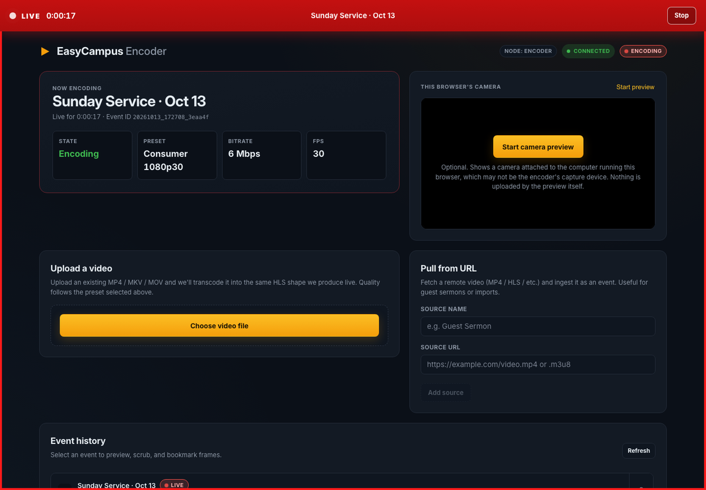
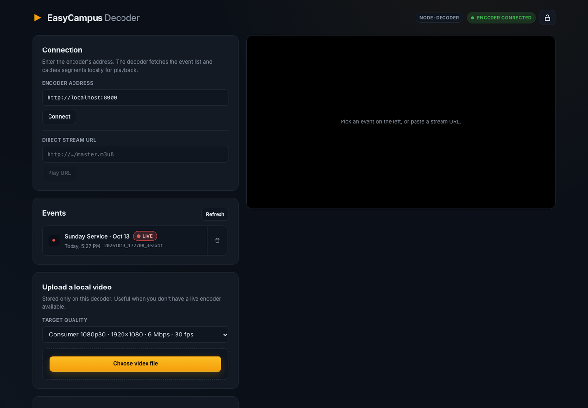

<p align="center">
  
</p>

<p align="center">
  <strong>Put the camera in the back of the room on the screen at the front.</strong><br>
  Live video for churches, classrooms, and community halls. No cloud, no accounts, no monthly bill.
</p>

---

EasyCampus turns two ordinary computers on the same network into a live video system. One computer sits by the camera and records. The other drives the projector or TV and plays the stream. Everything is recorded as it happens, so when someone asks "wait, what did she just say?" you can scroll back, replay it, and jump back to live.

<p align="center">
  
  <br><em>The encoder page during a live event.</em>
</p>

## What it does

- **Camera to screen over your own network.** Plug a webcam or capture card into one computer and a projector or TV into another. They talk over your building's Wi-Fi or Ethernet. Nothing goes to the internet.
- **Rewind while you're live.** Every event is recorded as it streams. Scrub back to any moment, drop bookmarks on the parts that matter, then jump back to live with one click.
- **Recordings that stick around.** When the event ends, the recording stays on disk. Play it back next week, or upload an existing video file to show it the same way.
- **Real full-screen output.** The playback computer drives the projector directly, full-screen with sound, instead of relying on a browser tab someone might accidentally close.
- **Lock it down.** The playback page has a lock button, so a curious visitor can't pause the service.
- **Quality that fits your connection.** Pick a preset from 480p up to 4K. The defaults are tuned for volunteer-run rooms on ordinary hardware.

## What you'll need

| Role | Hardware | Software |
| --- | --- | --- |
| **Encoder** (by the camera) | A Mac mini, small Linux box, or Windows PC with a webcam or capture card | [FFmpeg](https://ffmpeg.org/download.html) |
| **Decoder** (by the screen) | Any computer with HDMI to the projector or TV | [FFmpeg](https://ffmpeg.org/download.html) and [mpv](https://mpv.io/installation/) |

Both computers need to be on the same network. For a quick test, one computer can play both roles.

Installing the prerequisites:

```bash
# macOS
brew install ffmpeg mpv

# Debian / Ubuntu
sudo apt install ffmpeg mpv

# Fedora
sudo dnf install ffmpeg mpv

# Windows
winget install Gyan.FFmpeg
```

## Getting started

### 1. Download EasyCampus

Grab the latest build for your computer from the [Releases page](https://github.com/ssimpson89/easycampus/releases). There are downloads for macOS and Linux, for both Intel and Apple Silicon / ARM. Unzip it and you'll find a single `easycampus` program. Do this on both computers. On Windows, build it from source using [docs/development.md](docs/development.md).

### 2. Set up the encoder (the computer by the camera)

Tell it that it's the encoder, then start it:

```bash
./easycampus --set-type encoder
./easycampus
```

Open <http://localhost:8000> in a browser on that computer. You'll land on the encoder page. Give the event a name, pick your camera, choose a quality, and press **Start streaming**. The pre-flight checklist on the page tells you if anything is missing.

### 3. Set up the decoder (the computer by the screen)

A fresh install starts as a decoder, so just run it:

```bash
./easycampus
```

Open <http://localhost:8000> on that computer. Type the encoder's address into **Encoder address** (for example `http://encoder.local:8000` or `http://192.168.1.20:8000`) and press **Connect**. Pick the live event from the list, then press **Start projector** to send it full-screen to the display.

<p align="center">
  
  <br><em>The decoder page, connected and showing a live event.</em>
</p>

### 4. Let the two computers talk

The encoder only accepts control requests from web pages at addresses it trusts. This stops random websites from controlling it, but it isn't a password, so keep EasyCampus on a network you trust. If the decoder shows a "Couldn't reach" message that mentions `EASYCAMPUS_ALLOWED_ORIGINS`, start the encoder with the decoder's address added:

```bash
EASYCAMPUS_ALLOWED_ORIGINS=http://projector.local:8000 ./easycampus
```

Use whatever address you type into the decoder's browser to reach the decoder itself. Separate several addresses with commas. You can also save this permanently in the settings file below.

## Everyday use

- **Going live.** On the encoder, press **Start streaming**. A red LIVE banner with a timer appears across the top, and **Stop** is always in the corner.
- **Rewinding.** Drag the scrubber on either page to go back. Press **Go to live** to catch up.
- **Bookmarks.** Scrub to a key moment, like the start of the sermon, and press **Mark here**. Bookmarks made on the encoder show up on the decoder too, so the person at the screen can jump straight there.
- **Locking the screen.** On the decoder, press the lock icon in the top corner to stop accidental clicks from pausing or seeking the projector.
- **Playing a video file.** Use **Upload a video** to convert an MP4, MKV, or MOV and play it like any other event. The encoder can also pull a video from a web address with **Pull from URL**.
- **Past events.** Everything you've streamed appears in the event list. Pick one to watch it again, or delete it when you no longer need it.

## Settings

EasyCampus works out of the box. If you want to change something, edit the settings file it creates on first run:

- macOS and Linux: `~/.easycampus/config.yaml`
- Windows: `%USERPROFILE%\.easycampus\config.yaml`

The file has comments explaining each setting. The ones people usually change:

| Setting | Environment variable | What it does |
| --- | --- | --- |
| `node_type` | `EASYCAMPUS_NODE_TYPE` | `encoder` or `decoder`. Easiest to change with `--set-type`. |
| `port` | `EASYCAMPUS_PORT` | The web page port. Default `8000`. |
| `allowed_origins` | `EASYCAMPUS_ALLOWED_ORIGINS` | Addresses allowed to control this computer, such as the decoder's. |
| `default_encoder_url` | `EASYCAMPUS_DEFAULT_ENCODER_URL` | The encoder address the decoder fills in automatically. |

Environment variables override the file, which is handy for trying something once.

### Choosing a quality

Pick the quality from the menu on the encoder page; it remembers your last choice in that browser. If you're not sure, start with **Consumer 1080p30**. It needs about 8.5 Mbps of network capacity between the two computers and looks good on most projectors. Drop to 720p if the picture stutters. The higher tiers (prosumer, broadcast, cinema) are for 60 fps sports, professional capture cards, and film-rate content. [Quality presets](docs/quality-presets.md) has the full list.

## Troubleshooting

**The decoder says it couldn't reach the encoder.** Check that the encoder is running and that you can open its address in the decoder's browser. Then add the decoder's address to the encoder's allowed origins, as described in step 4.

**The encoder can't find my camera.** Press **Refresh devices**. On macOS, give your terminal app camera and microphone permission in System Settings, Privacy & Security. On Linux, make sure your user is in the `video` group.

**The picture on the projector is choppy.** Try a lower quality preset, or use a wired network connection for both computers.

**FFmpeg shows "Not detected" in the pre-flight check.** FFmpeg isn't installed or isn't on your `PATH`. Install it using the commands in [What you'll need](#what-youll-need), then restart EasyCampus.

**Nothing appears on the projector.** Make sure mpv is installed on the decoder computer, and pick the right screen in the **Display** menu on the decoder page before starting the projector.

## For developers

Build instructions, the configuration reference, the package layout, and `make` targets are in [docs/development.md](docs/development.md). The HTTP API is in [ROUTES.md](ROUTES.md). Playback tuning for specific TVs and projectors is in [docs/playback-profiles.md](docs/playback-profiles.md).

## License

No license file is committed yet, so treat the code as all rights reserved for now. Open an issue if you need a license decision before adopting it.
